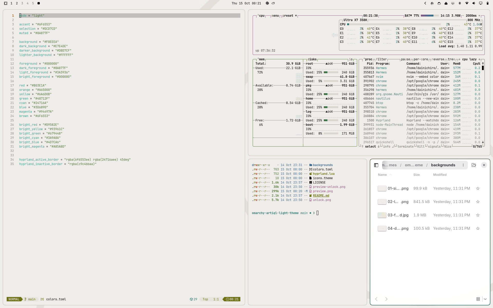
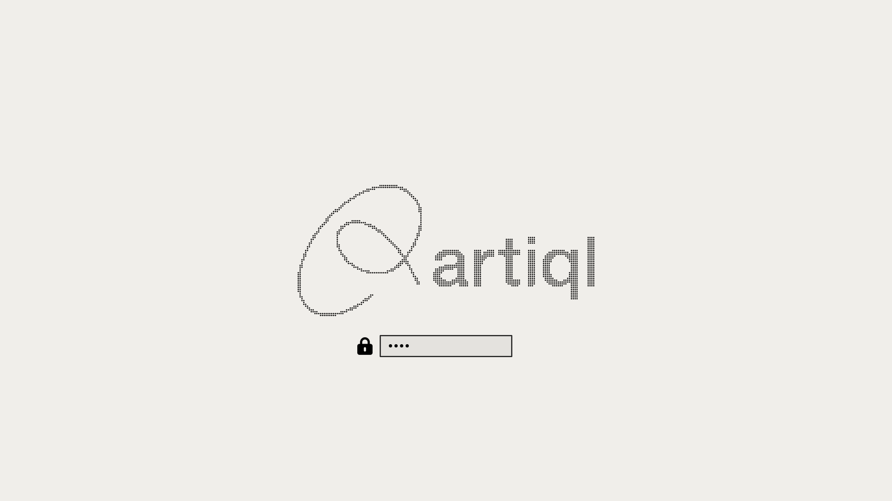

# Artiql Light

Paper-white, quiet and warm. A light theme for [Omarchy](https://omarchy.org).



## Install

Clone and link it, so the whole theme loads — including the rounded window
corners in [`hyprland.lua`](hyprland.lua):

```bash
git clone https://github.com/dainichiro/omarchy-artiql-light-theme.git ~/.local/share/omarchy-themes/artiql-light
ln -sT ~/.local/share/omarchy-themes/artiql-light ~/.config/omarchy/themes/artiql-light
omarchy theme set artiql-light
```

Update later with `git -C ~/.local/share/omarchy-themes/artiql-light pull`.

<details>
<summary>Colours only</summary>

```bash
omarchy theme install https://github.com/dainichiro/omarchy-artiql-light-theme
```

Omarchy skips every `.lua` in a theme installed this way, so windows keep
their square corners. Everything else — colours, backgrounds, unlock screen —
is the same.

</details>

A dark counterpart is available as
[Artiql](https://github.com/dainichiro/omarchy-artiql-theme).

### Window corners

`rounding = 8` keeps edges crisp; `rounding_power = 3` eases each straight
edge into the curve instead of meeting a circular arc.

### Boot unlock screen

```bash
omarchy plymouth set by theme artiql-light
```



## Backgrounds

Every mark sits well inside the frame, so the bar can live on any edge.

| | |
|---|---|
| `01-signature` | A small signature in the lower right |
| `02-loop` | The loop, enlarged into a faint line drawing |
| `03-field` | Soft fields of teal, orange and lime — no logo |
| `04-dots` | The logo as a dot matrix, echoing Omarchy's own |

## Palette

| Role | Colour |
|---|---|
| `background` | `#F0EEEA` |
| `foreground` | `#000000` |
| `accent` | `#6F6553` |
| `muted` | `#8A877F` |
| `selection` | `#DCD7CD` |
| `red` | `#B03E1A` |
| `orange` | `#A65000` |
| `yellow` | `#6A6D0B` |
| `green` | `#48712F` |
| `cyan` | `#24716A` |
| `blue` | `#3D6890` |
| `magenta` | `#94497A` |

## About the name

*artiql* is woven from four words — **question**, **circle**, **art** and
**article**: asking questions, holding many perspectives, making things
together, and sharing what we learn. This theme is a small piece of that
practice, made by people at [Artiql](https://artiql.jp).

## License

Theme configuration is MIT licensed. The Artiql name, logo and the images
derived from them are not covered by the MIT license — see
[BRAND-ASSETS.md](BRAND-ASSETS.md).
